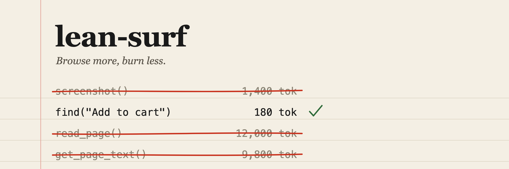

<p align="center">
  
</p>

<p align="center">
  <a href="LICENSE"></a>
  
  
  
  <a href="https://paypal.me/BEMahdi"></a>
</p>

<p align="center">
  <a href="README.md">English</a> · <b>Français</b>
</p>

---

Tu demandes à ton agent de relever trois prix sur une boutique. Il prend une capture d'écran, récupère tout l'arbre d'accessibilité, clique, reprend une capture pour « vérifier », récupère le texte de la page, clique sur « Suivant »…

Chacun de ces résultats **reste dans le contexte et est renvoyé à chaque tour suivant**. Une capture prise à l'étape 3 d'une tâche de 30 étapes est payée environ 27 fois de plus.

**lean-surf** obtient la même réponse avec une fraction des tokens.

## Ce qui change

|  | Agent par défaut | **lean-surf** |
|---|---|---|
| Page publique, lecture seule | ouvre un navigateur | **`curl` / fetch / API** |
| Longue tâche de navigation | dans le contexte principal | **sous-agent, ne renvoie que la réponse** |
| Lire une page | arbre ou texte complet | **`find` ou 5 lignes de JS** |
| Captures d'écran | après chaque clic | **seulement si c'est visuel, à `scale: 0.4`** |
| Vérifier qu'un clic a marché | capture d'écran | **URL ou vérification JS en une ligne** |
| Recherche, filtres, pagination | taper et cliquer | **construire l'URL, augmenter la taille de page** |
| Étape irréversible | — | **toujours vérifiée correctement** |

## Avant / après

*« Donne-moi le nom et le prix des 10 premiers produits de cette page. »*

<table>
<tr><th>Avant</th><th>Après (<code>full</code>)</th></tr>
<tr>
<td>

```text
screenshot()            ~1 400 tok
read_page()            ~12 000 tok
scroll + screenshot()   ~1 400 tok
get_page_text()         ~9 800 tok
```
**~24 600 tokens** dans le contexte, renvoyés à chaque tour suivant.

</td>
<td>

```js
[...document.querySelectorAll('.product')]
  .slice(0, 10).map(e => ({
    t: e.querySelector('h2')?.innerText.trim(),
    p: e.querySelector('.price')?.innerText.trim()
  }))
```
**~300 tokens.** Même réponse.

</td>
</tr>
</table>

<sub>Des ordres de grandeur, pas des benchmarks : ça dépend de la page et de la taille de la fenêtre.</sub>

<details>
<summary><b>La seule règle derrière tout ça</b></summary>

<br>

Avant chaque appel au navigateur, l'agent se demande :

> *Existe-t-il un appel moins cher qui ne renvoie que ce dont j'ai besoin ?*

Si oui, il utilise celui-là.

</details>

## Installation

**Claude Code** (en plugin) :

```text
/plugin marketplace add pixel-noir/lean-surf
/plugin install lean-surf@lean-surf
```

**Tout agent qui lit les `SKILL.md`** :

```bash
git clone https://github.com/pixel-noir/lean-surf.git
cp -r lean-surf/skills/lean-surf ~/.claude/skills/
```

## Utilisation

Il s'active tout seul dès qu'une tâche a besoin d'une page web ou d'un outil de navigation. Tu peux aussi dire `navigation économe`, `économise les tokens` ou `lean-surf`. Les déclencheurs anglais (`browse cheap`, `save tokens browsing`) marchent aussi. L'agent répond toujours dans ta langue.

Le mode reste actif toute la session. Pour l'arrêter, dis `surf off` ou `mode normal`.

Fonctionne avec **Claude in Chrome**, le **navigateur intégré**, **Playwright MCP** et **Chrome DevTools MCP**.

| Niveau | Ce qu'il fait |
|---|---|
| `lite` | Le bon outil d'abord, lectures ciblées, petites captures. Pas de délégation forcée. |
| `full` | **Par défaut.** Tout, plus un sous-agent pour toute tâche de plus de 3 actions, actions groupées et URL d'abord. |
| `ultra` | `full`, plus aucune capture sauf si la tâche est visuelle, délégation dès 2 actions, budget d'étapes, sortie d'extraction plafonnée. |

Change de niveau avec `lean-surf lite`, `lean-surf full` ou `lean-surf ultra`.

> [!IMPORTANT]
> **Certaines choses ne sont jamais coupées, quel que soit le niveau :**
> - une vraie vérification de la page avant toute action irréversible (envoyer, valider, payer, supprimer, publier)
> - pas de clic au hasard : si la lecture économe échoue, l'agent lit ou regarde correctement
> - une capture quand tu demandes à voir la page
> - les murs de connexion, CAPTCHA, identifiants et paiements te reviennent
> - un compte rendu de ce qui n'a pas été vérifié ou n'a pas pu charger

## Soutenir

Si ce projet t'a aidé, [offre-moi un café ☕️](https://paypal.me/BEMahdi).

## Licence

[MIT](LICENSE)
