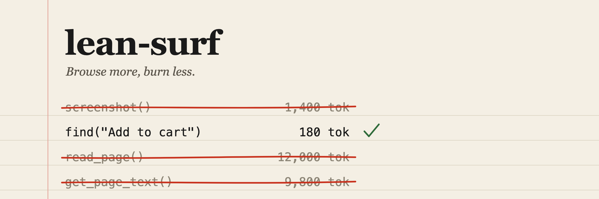

<p align="center">
  
</p>

<p align="center">
  <a href="LICENSE"></a>
  
  
  
  <a href="https://paypal.me/BEMahdi"></a>
</p>

<p align="center">
  <b>English</b> · <a href="README.fr.md">Français</a>
</p>

---

You ask your agent to grab three prices from a shop. It takes a screenshot, dumps the whole accessibility tree, clicks, takes another screenshot to "confirm", dumps the page text, clicks "Next"…

Every one of those results **stays in context and is re-sent on every later turn**. A screenshot at step 3 of a 30-step task is paid about 27 more times.

**lean-surf** gets the same answer with a fraction of the tokens.

## What it changes

|  | Default agent | **lean-surf** |
|---|---|---|
| Public page, read-only | opens a browser | **API / WebFetch, no browser** |
| Long browsing task | in the main context | **subagent, returns only the answer** |
| Reading a page | full tree or full text | **`find` or 5 lines of JS** |
| Screenshots | after every click | **only when visual, at `scale: 0.4`** |
| Checking a click worked | screenshot | **URL or one-line JS check** |
| Search, filters, paging | typing and clicking | **build the URL, raise page size** |
| Irreversible step | — | **always verified properly** |

## Before / after

*"Get the name and price of the first 10 products on this page."*

<table>
<tr><th>Before</th><th>After (<code>full</code>)</th></tr>
<tr>
<td>

```text
screenshot()            ~1,400 tok
read_page()            ~12,000 tok
scroll + screenshot()   ~1,400 tok
get_page_text()         ~9,800 tok
```
**~24,600 tokens** in context, re-sent on every later turn.

</td>
<td>

```js
[...document.querySelectorAll('.product')]
  .slice(0, 10).map(e => ({
    t: e.querySelector('h2')?.innerText.trim(),
    p: e.querySelector('.price')?.innerText.trim()
  }))
```
**~300 tokens.** Same answer.

</td>
</tr>
</table>

<sub>Orders of magnitude, not benchmarks: they depend on the page and the viewport.</sub>

<details>
<summary><b>The one rule behind it</b></summary>

<br>

Before every browser call, the agent asks itself:

> *Is there a cheaper call that returns only what I need?*

If yes, it uses that one.

</details>

## Install

**Claude Code** (as a plugin):

```text
/plugin marketplace add pixel-noir/lean-surf
/plugin install lean-surf@lean-surf
```

**Any agent that reads `SKILL.md`**:

```bash
git clone https://github.com/pixel-noir/lean-surf.git
cp -r lean-surf/skills/lean-surf ~/.claude/skills/
```

## Usage

It kicks in on its own as soon as a task needs a web page or a browser tool. You can also say `lean-surf`, `browse cheap` or `save tokens browsing`. In French, `navigation économe` or `économise les tokens` work too.

It stays on for the whole session. To turn it off, say `surf off` or `normal mode`.

Works with **Claude in Chrome**, the **built-in browser**, **Playwright MCP** and **Chrome DevTools MCP**.

| Level | What it does |
|---|---|
| `lite` | Right tool first, surgical reads, small screenshots. No forced delegation. |
| `full` | **Default.** Everything, plus a subagent for any task over 3 actions, batching and URL-first. |
| `ultra` | `full`, plus no screenshot unless the task is visual, delegation from 2 actions, step budget, capped extraction output. |

Switch levels with `lean-surf lite`, `lean-surf full` or `lean-surf ultra`.

> [!IMPORTANT]
> **Some things are never cut, whatever the level:**
> - a proper check of the page before any irreversible action (submit, send, pay, delete, publish)
> - no guessed clicks: if the cheap read fails, the agent reads or looks properly
> - a screenshot when you ask to see the page
> - sign-in walls, CAPTCHAs, credentials and payments go to you
> - a report of what wasn't checked or couldn't load

## Support

If this project helped you, [buy me a coffee ☕️](https://paypal.me/BEMahdi).

## License

[MIT](LICENSE)
